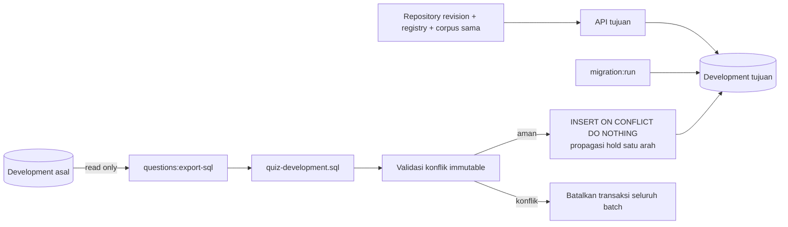

# Memindahkan bank soal development

Dokumen pendamping: [technical flow dan diagram](../../docs/TECHNICAL_FLOW.md).

## Database sama atau berbeda?

Jika komputer kantor dan rumah memakai **Neon database/branch/schema yang sama**, cukup gunakan konfigurasi privat yang sama dan repository revision yang cocok. Data sudah berada di server; tidak perlu insert ulang. Untuk database development terpisah, gunakan snapshot SQL di [exports/quiz-development.sql](../exports/quiz-development.sql).

Ekspor berisi seluruh versi `quiz_questions`, termasuk DRAFT, PUBLISHED dan karantina, agar identitas/version history konten tetap konsisten. Tidak membawa users, sessions, OAuth attempts, password, progress, hasil attempt, mistake pengguna, atau laporan. Metadata moderasi konten dapat mengandung nama operator. SQL mengandung **kunci jawaban privat**, jangan jadikan aset frontend.

Snapshot yang disiapkan 26 Oktober 2026 berisi **587 versi: 394 PUBLISHED, 193 DRAFT, 0 suspended**. Ini snapshot database aktual, bukan publikasi kandidat revisi baru. Sebagian versi published memakai otorisasi otomatis khusus development dan belum direview ahli.

## 1. Ekspor dari database asal

Dari direktori `api`, dengan `.env` menunjuk development asal:

```powershell
npm ci
npm run questions:export-sql
```

Perintah hanya membaca database asal dan menulis `api/exports/quiz-development.sql`. Ia menolak konfigurasi production dan pending schema migration. Exporter tidak meregenerasi soal atau mengubah gate publikasi. Jalankan ulang setelah ada perubahan bank/publikasi/karantina; tanggal snapshot dan jumlah aktual dapat dilihat pada header SQL dan output command.

## 2. Siapkan perangkat/database tujuan

Checkout **repository revision yang sama** dengan perangkat asal, termasuk:

- `api/content/reviewers.json` dan `source-approvals.json`: bukti publikasi yang sesungguhnya; jangan membuat reviewer atau approval palsu.
- `api/content/generated-candidates.json`, `generated-manifest.json`, `comprehension-cases.json`, `lesson-rule-map.json`, serta sumber materi/shared yang dipakai generator untuk workflow validasi berikutnya.
- `shared/` dan corpus reader yang cocok: `web/src/data/tajweed-index.json` serta `web/public/data/tajweed/`. Alternatif path corpus melalui `QUIZ_CORPUS_INDEX`/`QUIZ_CORPUS_DIRECTORY` harus memuat byte yang ekuivalen.

Set `.env` API ke database **development tujuan**. Jangan menyalin token sesi atau OAuth dari perangkat asal. Jalankan migration skema lebih dahulu:

```powershell
cd D:\apps\TajwidLens\api
npm ci
npm run migration:run
```

Migration saat dokumen dibuat: InitialAuth, LearningProgress, QuizAssessment, QuestionFeedback. `synchronize` tetap false. SQL ini hanya transfer data, bukan pengganti migration skema.

## 3. Jalankan query insert

Cara termudah: pilih development database/branch yang benar di **Neon SQL Editor**, buka `api/exports/quiz-development.sql`, salin seluruh isinya dan jalankan sebagai satu batch. Target tabel menggunakan `search_path` koneksi; untuk setup standar gunakan schema `public`. Pastikan editor memilih database tujuan sebelum menjalankan.

Atau dari PowerShell dengan PostgreSQL `psql` terpasang dan variabel `DATABASE_URL` proses menunjuk tujuan:

```powershell
psql --dbname="$env:DATABASE_URL" --set=ON_ERROR_STOP=1 --file="exports/quiz-development.sql"
```

`psql` tidak otomatis membaca `api/.env`; atur environment lokal secara privat. Jangan menempel credentials ke dokumen/commit. Script berjalan dalam transaksi dan menunggu lock maksimal 10 detik. Jika batch gagal pada editor, lakukan `ROLLBACK;` sebelum mencoba lagi pada koneksi yang sama.



## Sifat impor dan batasnya

- Aman dijalankan ulang: ID sama tidak menambah duplikat; unique `(stableId,contentVersion)` tetap berlaku.
- Jika ID/version sama tetapi isi immutable berbeda, seluruh impor gagal. Jangan menghapus guard atau mengedit jawaban pada versi yang sama; periksa revision/snapshot.
- Baris existing mempertahankan review, persetujuan, status publikasi dan tanggal. Impor tidak mempromosikan DRAFT existing menjadi PUBLISHED. Database tujuan kosong menerima metadata snapshot apa adanya; provenance tetap diperiksa runtime dari registry.
- Hold dari asal diterapkan ke baris yang belum held; hold yang sudah ada di tujuan tidak pernah dibuka. Tidak ada auto-release karantina.
- Ini transfer konten, bukan sinkronisasi database dua arah atau backup aplikasi penuh. Tidak menghapus versi tambahan yang sudah ada pada target; versi target yang lebih baru dapat tetap dipilih runtime. Gunakan database/branch development kosong untuk replika konten paling konsisten.
- SQL hanya menyalin otorisasi yang telah tercatat, tidak memberi otorisasi pada kandidat baru. Jalur otomatis development tetap tidak berlaku di production.

## 4. Verifikasi setelah impor

```sql
SELECT "reviewStatus", suspended, count(*) AS versions
FROM quiz_questions GROUP BY "reviewStatus", suspended
ORDER BY "reviewStatus", suspended;

SELECT "lessonId", count(*) AS published_not_held
FROM quiz_questions WHERE "reviewStatus" = 'PUBLISHED' AND NOT suspended
GROUP BY "lessonId" ORDER BY "lessonId";
```

Angka SQL kedua **bukan** jumlah eligible: runtime masih memeriksa provenance, versi terbaru, duplikasi dan integritas corpus. Restart API setelah mengganti registry, lalu periksa contohnya:

```text
GET http://localhost:4000/api/v1/quiz/lessons/pengantar/availability
GET http://localhost:4000/api/v1/detective/questions
```

Jika raw published ada tetapi unavailable, periksa registry/hash/corpus, `NODE_ENV`, hold dan pool tujuh soal, bukan mematikan gate. Untuk baris existing yang masih DRAFT, gunakan workflow publikasi eksplisit pada `api/content/README.md` bila persetujuan tepat versi memang tersedia. Tidak menyalin akun berarti pengembang perlu mendaftar/login sendiri di target untuk menguji quiz personal.

## Menguji query tanpa mengisi tabel aplikasi

```powershell
node -r ts-node/register --test test/quiz-transfer.test.ts
node -r ts-node/register scripts/verify-quiz-transfer.ts
```

Verifier kedua membutuhkan koneksi development dan hak membuat tabel TEMP. Ia menyalin struktur `public.quiz_questions` ke tabel sementara yang menutupi nama tabel asli hanya pada koneksinya, menjalankan SQL, memeriksa impor ulang/status/hold/konflik versi, lalu rollback. Tidak memigrasikan schema atau menulis akun/data bank pada tabel aplikasi.
