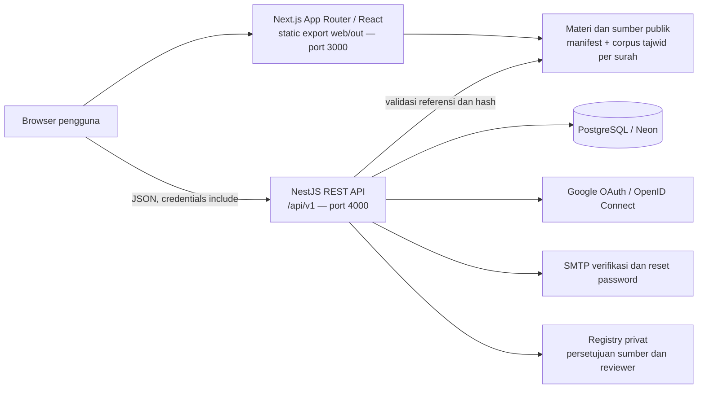
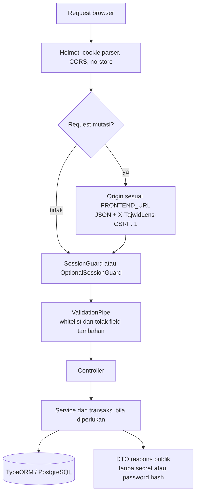
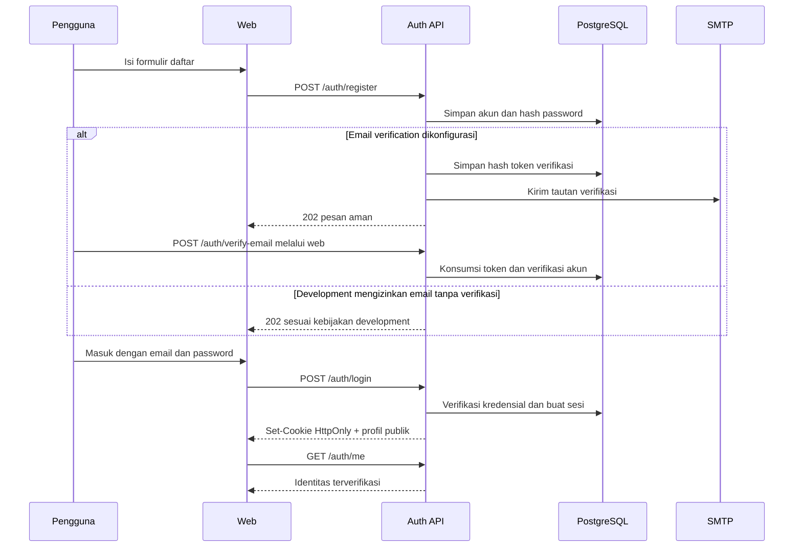
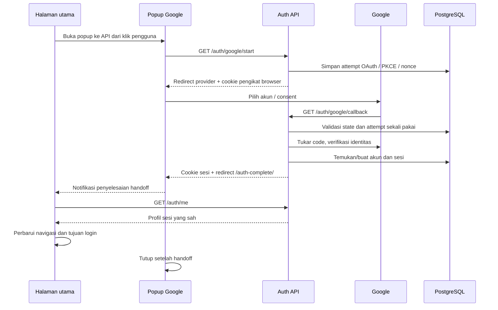
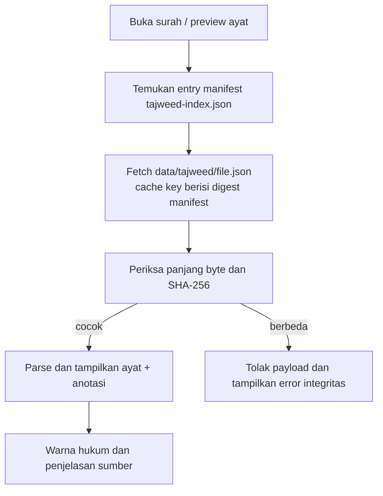
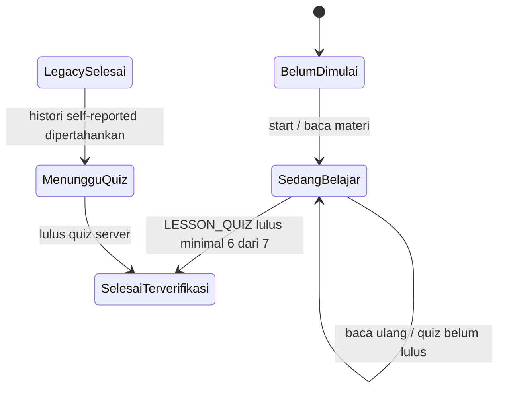
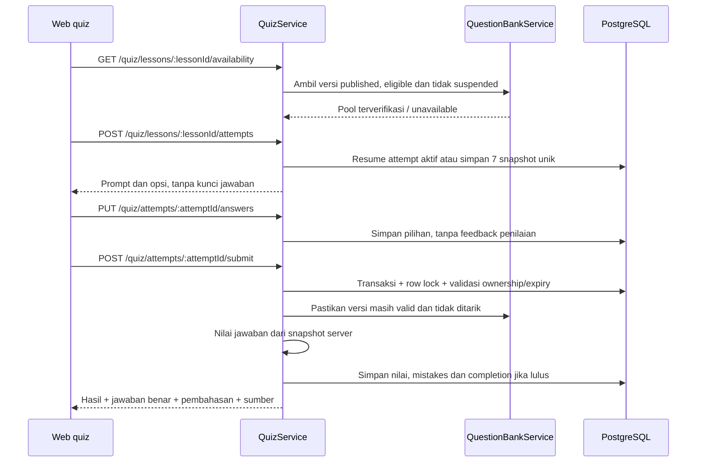
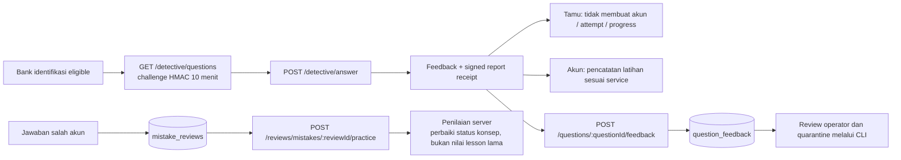
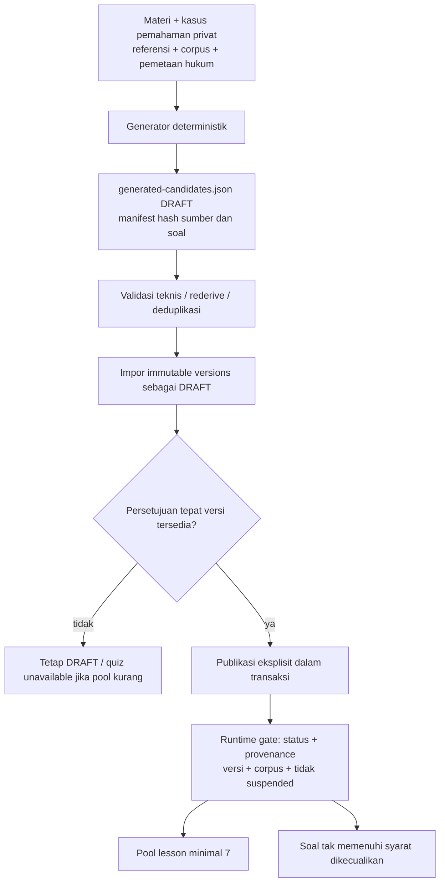
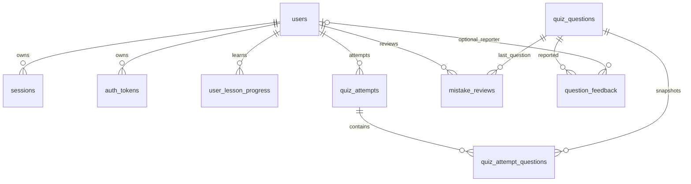

# TajwidLens — technical flow aplikasi

Dokumen berbasis implementasi repository pada 26 Oktober 2026. Diagram menggunakan Mermaid: buka preview Markdown yang mendukung Mermaid. Dokumentasi ini menjelaskan alur yang tersedia, bukan rancangan Phase 04. Status jumlah soal merupakan data operasional dan harus diperiksa dari database; jumlah kandidat JSON tidak sama dengan jumlah soal yang bisa dimainkan.

## 1. Arsitektur dan batas tanggung jawab

- `web/`: Next.js dengan static export. Materi, ilustrasi, tema dan reader dilayani sebagai aset statis. Interaksi personal meminta API dari browser; server frontend tidak menjalankan endpoint NestJS.
- `api/`: controller menerima request, guard/DTO memvalidasi, service menjalankan aturan bisnis, TypeORM mengakses PostgreSQL. Konfigurasi `synchronize:false`; perubahan skema melalui migration.
- `shared/`: katalog lesson, tipe kontrak quiz, materi pendukung dan kategori laporan. Katalog menyatukan identitas materi di frontend/backend.
- `api/content/`: bank kandidat, pemetaan sumber, manifest dan registry persetujuan. Berisi kunci jawaban; jangan disalin ke `web/public` atau bundle browser.
- Corpus reader tetap sumber koordinat ayat/anotasi. File Quran dari edisi berbeda tidak dapat dipertukarkan hanya berdasarkan nomor ayat.

Entry point: `api/src/main.ts`, `api/src/common/setup.ts`, `api/src/database/schema.ts`, `web/src/app/layout.tsx`. Dokumentasi endpoint aktual tersedia pada `http://localhost:4000/api/docs` ketika API hidup.

## 2. Request, sesi dan perlindungan API

Sesi memakai cookie HttpOnly tujuh hari; token sesi disimpan sebagai hash di database. Cookie development bernama `tajwidlens`, production `__Host-tajwidlens` dengan Secure. Protected request memverifikasi sesi dan pemilik data di server. CORS mengizinkan origin frontend yang dikonfigurasi, bukan sembarang origin. DTO menolak field tak dikenal. Error internal disajikan sebagai pesan aman. Rate limiter tetap berlaku.

Auth client: `web/src/lib/auth-api.ts`. Middleware: `api/src/common/setup.ts`. Jangan menyimpan token sesi di localStorage atau menganggap status UI sebagai bukti autentikasi.

## 3. Registrasi email, login dan profil

`GET /auth/status` memang tersedia sekarang: melaporkan kapabilitas Google, registrasi dan pengiriman email, tanpa credentials. Registrasi tidak dianggap otomatis login. Respons pendaftaran sengaja tidak membocorkan keberadaan email. Mode email tanpa verifikasi hanya development/test dengan konfigurasi eksplisit.

Profil dibaca/diperbarui melalui `GET/PATCH /users/me`. Logout menggunakan `POST /auth/logout`, menghapus sesi server dan cookie, lalu frontend memperbarui state. Lupa/reset password memakai token sekali pakai; token mentah tidak menjadi data portabel.

## 4. Google login dan handoff popup

Notifikasi popup hanya pemicu refresh: keberhasilan tetap ditentukan API sesi. Ada recovery/fallback apabila popup atau pesan handoff gagal. Google callback wajib mengarah ke API yang hidup; web port 3000 dan API port 4000 harus sama-sama berjalan. Akun email existing tidak boleh ditautkan hanya karena alamat email sama; jalur link eksplisit memerlukan sesi dan konfirmasi password (`POST /auth/google/link`). Jangan menyalin OAuth authorization code/state antarperangkat.

Handoff menggunakan BroadcastChannel pada origin frontend dengan acknowledgement setelah refresh sesi. Endpoint `POST /auth/google/start` juga tersedia untuk respons URL JSON, tetapi tombol login saat ini langsung membuka jalur GET agar popup tidak menunggu fetch lintas origin.

## 5. Reader dan integritas tajwid

Implementasi: `web/src/lib/tajweed-data.ts`. Manifest dan payload harus berasal dari build yang sama. Perubahan line ending, aset lama di cache, atau mencampur `out/` dari versi berbeda dapat merusak hash. Jangan mengatasi error dengan mematikan pemeriksaan integritas. Pipeline `tajweed:build`/`tajweed:check` memeriksa data sebelum build. Backend quiz juga mencocokkan edisi, verse hash, annotation ID serta batas grapheme/UTF-16 melalui `QuizCorpus`.

## 6. Belajar, progress dan dashboard

Pengunjung bisa membaca materi publik. Setelah login, membuka/memulai materi memanggil `PUT /learning/progress/:lessonId/start`; riwayat tersimpan per pasangan akun/materi. Dashboard mengambil `GET /learning/dashboard`; daftar/detail progress memakai `/learning/progress` dan `/learning/progress/:lessonId`.

Status UI diturunkan dari progress dan `completionSource`, bukan empat nilai literal pada kolom status. Database menyimpan `IN_PROGRESS/COMPLETED`, provenance `LEGACY_SELF_REPORTED/QUIZ_VERIFIED`, dan tanggal historis. `PUT .../complete` manual ditolak 403. Membaca, Detective, serta Replay tidak memberi kelulusan lesson.

## 7. Lifecycle quiz dan hasil

Attempt lesson berlaku 24 jam. Pemilihan memakai tujuh soal unik dan mencakup kedua tipe bila tersedia. Urutan soal/opsi disimpan agar refresh melanjutkan attempt yang sama. Server menentukan nilai dan kelulusan minimal 6/7; submit ulang mengembalikan hasil yang sama. Semua perubahan penilaian/progress/mistake berada dalam transaksi. Snapshot menjaga konteks histori meskipun versi baru diterbitkan; soal held dapat menghalangi penilaian attempt yang masih aktif.

Kode utama: `quiz.service.ts`, `engine.ts`, `question-bank.service.ts` di `api/src/modules/quiz/`. Kontrak publik: `shared/quiz.ts`. Halaman hasil menerima feedback setelah submit, bukan seluruh bank atau answer key sebelum penilaian.

## 8. Detective, Replay dan laporan

Replay memerlukan alternatif soal eligible pada konsep yang sama; bila tidak ada, aplikasi menyatakan unavailable. Laporan memerlukan attempt submitted milik pengguna atau receipt hasil Detective yang sah. Receipt laporan tamu berlaku 24 jam; limiter laporan lima/IP/endpoint/menit. Laporan tidak otomatis mengubah kunci, skor atau publikasi. Karantina dilakukan operator melalui CLI, mempertahankan snapshot dan audit moderasi. Production Detective memerlukan `QUIZ_CHALLENGE_SECRET` stabil; development tanpa konfigurasi menggunakan key sementara sehingga restart membatalkan challenge sebelumnya.

## 9. Pipeline konten dan publikasi

Ada dua jenis bukti berbeda: review ahli tepercaya, atau otorisasi pemilik untuk **versi otomatis tertentu khusus development**. Validasi teknis dan status upstream stable tidak berarti review ilmiah. Registry mematok sourceVersion/questionHashes; mengganti sumber tidak memperluas persetujuan lama. Jalur `REPOSITORY_DETERMINISTIC` ditolak pada `NODE_ENV=production`. Kandidat di file tetap DRAFT walaupun versi database sudah terpublikasi. Referensi tetap tersedia di navigasi aplikasi.

Perintah workflow dan kebijakan detail: [content README](../api/content/README.md). Ekspor SQL membawa status database yang sudah ada, bukan membuat persetujuan baru; lihat [pemindahan bank soal](../api/docs/QUIZ_DATA_TRANSFER.md).

## 10. Relasi data inti

Diagram menggambarkan relasi logis; tidak semua relasi auth mempunyai foreign key TypeORM. `oauth_attempts` mengikat browser/state/PKCE dan bersifat sementara, bukan data bank soal. Unik utama: question `(stableId,contentVersion)`, progress `(userId,lessonId)`, mistake `(userId,lessonId,conceptId)`. Question attempt menyimpan snapshot JSON, ordinal dan pilihan; answer key hanya privat di server.

## 11. Menjalankan di perangkat development lain

1. Checkout repository revision yang sama; install dependency dengan `npm ci` secara terpisah di `api` dan `web`.
2. Konfigurasikan `.env` secara privat dari contoh repository. Jangan commit credentials. `DATABASE_URL` menunjuk database development; origin frontend/API harus sesuai port yang dipakai.
3. Di `api`, jalankan `npm run migration:run`, lalu impor bank bila database berbeda mengikuti panduan transfer.
4. Jalankan API `npm run dev` atau `npm run build` lalu `npm run start`.
5. Jalankan web `npm run dev`, atau `npm run build` lalu `npm run start` untuk melayani `out/`. Nilai public API origin dibaca ketika build; rebuild jika berubah.
6. Cek `GET /api/v1/auth/status`, `/api/docs`, availability quiz dan halaman reader. Jika memakai Neon database yang sama, data quiz sudah dibagi lintas perangkat sehingga tidak perlu impor SQL.

Tidak termasuk: analytics/admin Phase 04, deployment production, penilaian pelafalan suara, serta klaim validasi ilmiah atas bank otomatis. Dokumen ini tidak menggantikan pemeriksaan sumber atau pengujian integrasi yang tercatat pada CHECKPOINT.
